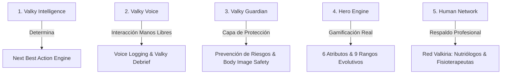

# VALKY 369 — PRODUCT VISION V2
**Documento de Visión de Producto & Manifiesto del Compañero Inteligente**  
*Fecha: Agosto 2026 | Versión: 2.0-Consolidated*

---

## 1. DEFINICIÓN DEL PRODUCTO

> **Valky 369 es un compañero inteligente de transformación física y personal que escucha al usuario, comprende su estado, adapta la siguiente acción que debería realizar y convierte su progreso real en la evolución de un héroe, protegiéndolo al mismo tiempo de los extremos dañinos de la cultura fitness.**

Valky 369 deja de ser una colección dispersa de utilidades fitness para convertirse en un **ecosistema conectado de acompañamiento longitudinal y humanizado**. Combina la fisiología del entrenamiento de fuerza, la nutrición clínica basada en evidencia (visión de Valkiria), la psicología del comportamiento y la emoción del RPG de superhéroes bajo un principio rector inquebrantable:

> *Valky jamás debe hacer que una persona odie su cuerpo para conseguir que cuide de él.*

---

## 2. EL PROBLEMA REAL QUE RESOLVEMOS

1. **La Paradoja de la Fricción en el Fitness**: Las personas abandonan en los primeros 30 días no por falta de deseo, sino porque las apps tradicionales exigen una carga cognitiva abrumadora (pesar cada gramo de comida, navegar 15 pantallas en el gimnasio con manos sudadas, lidiar con interfaces mecánicas).
2. **Cultura Fitness Tóxica & Culpa**: La industria promueve mensajes perjudiciales (*"quema lo que comiste"*, *"sin dolor no hay gloria"*, castigos de rachas rotas por enfermarse o descansar). Esto fomenta trastornos de la conducta alimentaria (TCA), dismorfia corporal y sobreentrenamiento.
3. **El Silo Aislado**: Apps de entrenamiento no hablan con la nutrición; calculadoras de calorías no entienden la fatiga del entrenamiento; los wearables muestran números abstractos sin decirte exactamente *qué hacer ahora*.

---

## 3. LOS 5 SISTEMAS PRINCIPALES DE VALKY 369



### 1. Valky Intelligence (Motor de Decisión Proactivo)
No es un simple chatbot pasivo que espera a que el usuario escriba. Es un motor orquestador que analiza:
- Estado del Héroe (Daily Readiness Score multi-factor: sueño + fatiga + estrés).
- Procedencia de datos categorizada: `MEASURED`, `USER_REPORTED`, `PROFESSIONAL_DEFINED`, `AI_INFERRED`.
- Determina la **Próxima Mejor Acción (Next Best Action)** en menos de 3 segundos.

### 2. Valky Voice (Interfaz de Voz Fluida para el Gimnasio)
Diseñado específicamente para el contexto real de entrenamiento (sudor, fatiga, manos ocupadas).
- **Categorías de Voz**:
  - `COMMAND` (*"Valky, registra 80 kilos por 8"*).
  - `OBSERVATION` (*"En la última serie me molestó el hombro"*).
  - `QUESTION` (*"¿Crees que debería entrenar mañana?"*).
  - `REFLECTION` (*"Siento que llevo semanas sin progresar"*).
- **Valky Debrief**: Experiencia de audio post-entrenamiento de 20 segundos donde el usuario cuenta cómo se sintió y el sistema extrae automáticamente series, dificultad percibida y fatiga con confirmación interactiva.

### 3. Valky Guardian (Capa Transversal de Seguridad & No-Toxicidad)
- **NO es terapia ni sustituto médico**.
- Detecta y previene señales de riesgo en:
  - *Imagen Corporal*: Comparación destructiva, dismorfia, lenguaje auto-denigrante.
  - *Nutrición*: Restricción extrema, compensación de comidas con ejercicio, obsesión calórica.
  - *Entrenamiento*: Ejercicio compulsivo pese a lesiones o dolor agudo.
  - *Bienestar Emocional*: Acompañamiento con la opción triple: `[ Solo escúchame ]`, `[ Ayúdame a verlo diferente ]`, `[ Ayúdame a decidir qué hacer ]`.
- **Guardián de la Racha**: La recuperación activa, misiones de movilidad o descanso prescrito mantienen la racha (*RECOVERY = PROGRESS*).

### 4. Hero Engine (Gamificación de Acciones Reales)
- El Código 3-6-9:
  - **3 Pilares**: Hero RPG + Red Valkiria + Valky AI Companion.
  - **6 Atributos**: Fuerza (STR), Resistencia (END), Nutrición (VIT), Agilidad (AGI), Disciplina (MND), Recuperación (REC).
  - **9 Rangos**: Desde *Iniciado* hasta *Valkyria Suprema Lvl 99*.
- `HeroProgressionService` centralizado con protección anti-farming.

### 5. Human Network (Red Valkiria de Especialistas)
- Sinergia humano-IA: La IA resuelve el acompañamiento diario y la fricción cotidiana; los nutriólogos y profesionales clínicos realizan la evaluación de base y prescriben el plan nutricional real.

---

## 4. EL CORE LOOP DE PRODUCTO

```text
CHECK-IN (Readiness)
      ↓
NEXT BEST ACTION
      ↓
WORKOUT (Voice Logging)
      ↓
VALKY DEBRIEF (15s Audio / Texto)
      ↓
GUARDIAN SAFETY CHECK
      ↓
XP / ATRIBUTOS / STATS
      ↓
RECOVERY & NUTRICIÓN
      ↓
PRÓXIMO DÍA
```

---

## 5. LÍMITES Y PRINCIPIOS ÉTICOS

1. Valky nunca diagnostica enfermedades ni lesiones clínicas.
2. Valky nunca prescribe dietas restrictivas extremas ni fomenta déficits agresivos.
3. El audio es **efímero por defecto** (`Audio Ephemeral by Default`): procesar, extraer, persistir estructura y eliminar audio de memoria.
